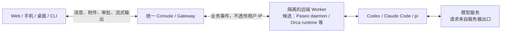

# Agent 开发工作台：开源方案调研与选型建议

- 项目：ohoo
- 资料核查截至：2026-10-26
- 归档日期：2026-10-28（Asia/Taipei）
- 补充核查：2026-11-02 加入 Orca（`stablyai/orca`），更新候选定位与 PoC 范围；其余产品沿用原核查基线，并引用本次评审已复核的接口资料，不代表全部重新核验。
- 方法：官方文档、GitHub 仓库、版本记录及部分适配器源码审查。
- 验证范围：资料与源码级调研；尚未安装部署、压测或验证端到端隔离效果。归档不代表在归档日期重新核验全部上游状态。
- 证据说明：产品能力引用官方来源；架构推断与 ohoo 的设计建议单独说明。指向 `main` 的链接会随上游更新，实施前需要固定版本或 commit。

## 1. 结论与选型建议

针对“开发自己的多终端 agent 工作台”，建议将 **Paseo 与 Orca 同列为自研底座的优先验证候选**：Paseo 重点验证 daemon、provider 适配器和 TypeScript SDK 的接入成本；Orca 重点验证完整远程 runtime、结构化 agent 会话和执行环境管理的复用价值。ohoo 的统一 console、身份与权限、会话路由和隔离边界仍需单独建设。现有证据支持候选优先级，尚不足以确定最终底座。

建议首轮 PoC 同时比较：

| 候选 | 主要验证目的 | 建议定位 |
| --- | --- | --- |
| Paseo | 多 agent 适配、SDK 可复用性、多终端会话体验 | 优先验证 daemon / SDK 接入路线 |
| Orca | `orca serve`、结构化会话、跨设备接续、环境生命周期 | 与 Paseo 同轮比较的完整工作台 runtime 候选 |
| HAPI | 中心 Hub 汇聚客户端与远端 runner 的链路 | 快速搭建内部集中 console 的首选 |
| T3 Code | 远程环境管理、移动端、SSH 和 ACP 体验 | 客户端体验与环境管理的重点对照 |

以上是本次调研的选型判断，不是实测排名。如果目标只是让一个可信小团队尽快使用现成的集中 console，HAPI 的优先级更高；如果目标是构建自己的产品，应以同一条 ohoo gateway 链路比较 Paseo 与 Orca 的接口覆盖和改造量。Orca 已有 headless server 和结构化 agent 接入，不宜仅作为桌面 UI 参考。详细比较与限制见 §4.6。

## 2. 场景与边界

目标链路是：

> 浏览器、手机、桌面、CLI 等终端 → 统一 Console / Gateway → 远端 agent 执行环境 → Codex / Claude Code / pi 等完整 agent 运行时。

平台需要传递消息、附件、流式输出、工具事件、审批、取消和会话恢复等信息。跨 agent 的统一入口不意味着不同 agent 可以无损共享原生隐藏上下文；跨 agent 交接应定义明确的摘要、文件和任务状态协议。

“远程 agent 不关心用户真实 IP”需要拆分为不同目标：

| 目标 | 成立条件与限制 |
| --- | --- |
| 模型推理请求使用服务器 IP | agent 在服务器执行，由服务器发出推理请求；模型服务看到该连接的服务器或代理出口地址。这是网络架构推断，不是匿名承诺。 |
| agent 执行机器不直接接触用户 IP | 客户端只连接 gateway，worker 只通过独立通道与 gateway 通信，且不向 worker 透传客户端 IP、原始请求头等元数据。 |
| Console / relay 也不知道用户 IP | 下述产品通常不提供此保证；接入服务仍能看到连接来源。端到端加密保护内容，不等于隐藏网络元数据。 |

IP 解耦不等于隐藏账号身份。账号授权、用户主动输入的内容和应用日志仍可能关联身份。

## 3. Paseo 的功能与架构

Paseo 是客户端加 daemon 的架构。daemon 运行在实际执行 agent 的机器上，客户端通过 WebSocket 连接，daemon 管理 agent 的生命周期；执行机器可以是工作站、VPS、VM 或 Docker 容器。[官方安全与架构说明](https://paseo.sh/docs/security)

| 能力 | 官方确认的情况 | 对 ohoo 的价值 |
| --- | --- | --- |
| 多 agent | 原生支持 Claude Code、Codex、Pi、OpenCode 等；也可使用 ACP catalog 或自定义 provider 插件 | 第一阶段不用从零维护三套完整适配器 |
| 多终端 | 桌面、iOS、Android、Web、CLI | 可验证不同设备操作远端会话的体验 |
| 开发工作台 | terminal、文件编辑、diff、worktree、多 agent 并行、语音等 | 可直接验证较完整的开发流程 |
| 程序化控制 | `@getpaseo/client` TypeScript SDK 创建 agent、发送后续输入、接收结果 | 适合自建 console 和业务入口 |
| 网络连接 | 支持直连及可选 relay；relay 模式由 daemon 主动向外连接 | 减少远端机器的入站网络配置 |

来源：[支持的 providers](https://paseo.sh/docs/supported-providers)、[官方仓库](https://github.com/getpaseo/paseo)、[SDK 文档](https://paseo.sh/docs/sdk)、[连接方式](https://paseo.sh/docs/connectivity)。

底层 CLI 需要在 daemon 主机上安装并完成认证。各 provider 的功能覆盖存在差异，不应把“支持该 agent”理解为它的全部原生能力都已完整映射到统一 UI。[Provider 说明](https://paseo.sh/docs/providers)

### 3.1 最值得复用的部分

SDK 创建的 agent 会进入正常 Paseo UI；调用程序退出后，会话仍可以保留。SDK 文档明确列出运行并行 agent、保持会话、发送后续输入和构建 dashboard 等用途。这是将 Paseo 作为执行服务、在外层构建 ohoo 的主要依据。[SDK 文档](https://paseo.sh/docs/sdk)

### 3.2 Hub 的定位

Paseo Hub 是独立的开源自动化层，可将 GitHub、Slack、Discord 等外部事件或手工请求转成 trigger / workflow，再调度 daemon 执行 agent，并记录运行结果。它提供组织级 API key 和 scopes。[Hub 工作原理](https://paseo.sh/docs/hub/concepts)、[Hub API](https://paseo.sh/docs/hub/api)

Hub 不是现有所有原生客户端的统一登录总入口；客户端和 daemon 的连接关系仍需单独设计。Hub 仓库声明处于早期开发，可能发生不兼容变更和数据丢失，因此不能假设其已经覆盖完整产品控制面。[Hub 产品说明](https://paseo.sh/hub)、[独立 Hub 仓库](https://github.com/getpaseo/hub)

### 3.3 隔离与审批限制

Hub 不沙箱化 provider 进程，也不提供跨 provider 的统一 sandbox 抽象。多用户场景需要独立 OS 用户、容器或 VM 等执行边界；worktree 解决代码分支隔离，不能替代租户隔离。[Hub 安全文档](https://paseo.sh/docs/hub/security)

Pi 的原生 RPC 接入和扩展交互有适配支持，但不应由统一 UI 中存在审批或提问按钮，推导其具有与 Claude Code、Codex 等同的工具级审批能力。Paseo pi 适配器未提供统一可选权限模式，工具权限需按 Pi 本身及扩展核查。[Pi adapter 源码](https://github.com/getpaseo/paseo/blob/main/packages/server/src/server/agent/providers/pi/agent.ts)、[Provider 开发文档](https://github.com/getpaseo/paseo/blob/main/docs/providers.md)

### 3.4 许可与迭代状态

本次核验的 Paseo v0.13.0 于 2026-10-24 发布，新增 connected hosts 等多机能力。该 tag 的 LICENSE 为 Apache-2.0，第三方组件保留各自许可；Hub 独立仓库同样标为 Apache-2.0。项目仍处于 0.x 快速迭代阶段，实施前应固定具体版本。[v0.13.0 发布](https://github.com/getpaseo/paseo/releases/tag/v0.13.0)、[该版本 LICENSE](https://raw.githubusercontent.com/getpaseo/paseo/v0.13.0/LICENSE)、[Hub LICENSE](https://github.com/getpaseo/hub/blob/main/LICENSE)

## 4. 类似开源产品对比

以下许可指核查时的主仓库，具体依赖和选定版本需要另行核对。

| 方案 | Agent 与终端覆盖 | 架构特点 | 对 ohoo 的判断 |
| --- | --- | --- | --- |
| Paseo；Apache-2.0 | Codex、Claude Code、pi 原生适配；桌面、手机、Web、CLI | daemon 管理 agent，SDK 可驱动执行层 | 优先验证 SDK 与事件流，与 Orca 比较集成成本 |
| Orca；MIT | Codex、Claude Code、pi 结构化接入及通用 CLI；桌面、手机、Web、CLI | `orca serve` / orcad 持有远端会话；另有 SSH、编排及实验性环境 recipes | 完整远程工作台强候选；Remote Servers 为 beta，Chat UI 为实验性功能 |
| HAPI；AGPL-3.0 | 支持三者；Web/PWA、原生手机、Telegram、终端 wrapper | Hub 居中，客户端与远端 runner 分别连接 Hub，历史存 SQLite | 最接近现成的内部集中 console |
| T3 Code；MIT | Claude/Codex 接入；pi 可通过 ACP；桌面、Web、手机和命令式 CLI | 按 environment 管理服务，支持 SSH、配对和 T3 Connect | 远程开发体验强备选，多租户仍需补建 |
| AionUi；Apache-2.0 | 三者经 ACP / 兼容适配器接入；桌面、Web、手机浏览器、飞书等渠道 | 偏通用 Cowork，可独立部署 WebUI | 聊天渠道优先时值得考虑；当前 WebUI 为单用户 |
| Harness Remote；Apache-2.0 | 支持三者；桌面、Web、Android | 每台机器一个 gateway，保留原生会话与恢复语义 | 适合参考会话管理，中心公网入口需另建 |
| Happy；MIT | 当前支持 Claude/Codex 原生 harness 和通用 ACP；桌面、手机等 | 有自有运行时，也可调用外部 agent harness | 需区分产品代际及具体运行模式；pi 路径需要验证 |

### 4.1 HAPI

HAPI 的结构是 `客户端 REST/SSE ↔ Hub + SQLite ↔ Socket.IO ↔ CLI / Runner`。Hub 可以在 VPS，runner 在其他机器；支持远程创建会话、审批、文件/Git 和 Web terminal，拓扑与集中 console 非常接近。[架构与数据流](https://hapi.run/docs/guide/how-it-works)

其支持矩阵明确区分：Claude Code 本地 wrapper / 远端 SDK、Codex 原生 terminal / app-server、pi JSON-line RPC。Pi 当前只有远程 UI 输入路径，无 local TUI 输入模式，工具权限标为 always auto-approve。因此必须逐 agent 验证审批语义。[支持矩阵](https://hapi.run/docs/guide/agents)

Namespace 面向共享 Hub 的小团队，使用基础 token 加 `:namespace` 区分会话与机器。它不能直接视为面向不可信客户的独立账号与 RBAC 系统；这是本次基于认证设计作出的判断。[Namespace 文档](https://hapi.run/docs/guide/namespace)、[官方仓库与许可](https://github.com/tiann/hapi)

### 4.2 T3 Code

T3 Code 提供桌面、Web 和手机客户端，可连接不同环境。桌面端可通过 SSH 启动或复用远端 server；T3 Connect、LAN、Tailscale 和配对是不同接入路径。ACP 文档明确说明 registry agent 运行在 T3 server 所在机器，pi 可通过通用 ACP 集成使用。[官方仓库与许可](https://github.com/pingdotgg/t3code)、[远程接入](https://github.com/pingdotgg/t3code/blob/main/docs/user/remote-access.md)、[ACP providers](https://github.com/pingdotgg/t3code/blob/main/docs/user/providers-acp.md)

需要区分命令式 CLI 和完整交互 TUI：本次源码审查发现 `t3 thread` 有 list / start / send / show 等子命令；其工具调用按本机 server 与机器 owner 身份工作，远端终端可以 SSH 后使用。遇到审批或提问时需进入 T3 Code UI 处理，不能直接把它描述成完整交互式远程 TUI。[CLI 源码](https://github.com/pingdotgg/t3code/blob/main/apps/server/src/cli/thread.ts)

环境配对提供 scoped session，默认设备授权面向可信操作者。单线程 guest link 也不能等同组织 / 项目级多租户管理。[环境认证设计](https://github.com/pingdotgg/t3code/blob/main/docs/internals/environment-auth.md)、[Guest links](https://github.com/pingdotgg/t3code/blob/main/docs/user/guest-links.md)

### 4.3 AionUi

外部 agent 模式支持 Claude Code、Codex、pi 等，使用 ACP 或兼容适配器，各 agent 保持自己的认证和能力。WebUI 可以独立运行在 headless server，并通过手机浏览器或飞书等渠道使用。[ACP 配置](https://github.com/iOfficeAI/AionUi/wiki/acp-setup)、[官方仓库与许可](https://github.com/iOfficeAI/AionUi)

官方 WebUI 文档明确目前只有 `admin` 单用户，多用户仍在规划。因此适合个人或受信任场景的统一工作台，不能直接当作多人平台。[WebUI 配置与限制](https://github.com/iOfficeAI/AionUi/wiki/WebUI-Configuration-Guide#single-user-only-for-now)

### 4.4 Harness Remote

重点是发现、观察、恢复和延续各 agent 的原生会话，支持多机器。跨 agent continuation 传递有限、可检查的任务上下文，目标 agent 仍拥有自己的原生会话。官方要求 gateway 通过可信 LAN 或 VPN 使用，不应直接暴露公网。[官方仓库](https://github.com/giuliastro/harness-remote)

对 ohoo 的参考价值是原生 session 的管理方式；若要统一公网 console，需要补中心 broker / gateway。

### 4.5 Happy

旧 Happy CLI 已进入维护模式，重要修复继续，新功能主要进入当前桌面产品。[旧 CLI 文档](https://happy.engineering/docs/)

当前 Happy 既可以运行自己的 loop，也可配置 `claude_code`、`codex_cli` 和通用 ACP harness。不能简单归类为只运行自有 agent；也不能把默认模型支持直接等同原生 CLI 支持。Pi 可以考察 ACP 路径，但本次未实测。[Harness 配置](https://happy.engineering/recepies/harnesses/)、[远端服务器模式](https://happy.engineering/guides/remote-server/)、[官方仓库与许可](https://github.com/slopus/happy)

### 4.6 Orca（2026-11-02 补充）

本节指 **[stablyai/orca](https://github.com/stablyai/orca)**。源码抽查固定在 commit [`8458e704c4f2`](https://github.com/stablyai/orca/commit/8458e704c4f2f6784366f208ab8e90b40869517c)，该提交主许可证为 MIT；产品文档为本次核查时的在线版本，能力仍需在实际部署版本验证。[固定提交 LICENSE](https://github.com/stablyai/orca/blob/8458e704c4f2f6784366f208ab8e90b40869517c/LICENSE)

**远端运行与多终端。** Orca 支持桌面运行、SSH worktree、Remote Orca Server，以及按 workspace 创建的环境。`orca serve` 可无桌面窗口启动运行时，默认使用 Node 实现的 orcad，部分平台或失败路径会回退到 Electron server。远端 server 持有项目、worktree、终端、provider 账号和 agent 会话，桌面、浏览器、手机及自动化客户端连接它；底层 agent CLI 需在执行主机安装并认证。Remote Servers 官方仍标为 beta，建议经私网、VPN 或受控隧道接入。[运行方式](https://www.onorca.dev/docs/ways-to-run)、[Remote Orca Servers](https://www.onorca.dev/docs/remote-servers)

**Agent 接入有两种层次。** 通用 CLI 可通过终端运行；Claude Code、Codex、Pi 等另有结构化 Chat UI，可展示工具事件并处理受支持的交互、停止和恢复。结构化模式适用于本地及持有 workspace 的 paired Orca Server；官方 Chat UI 文档将纯 SSH / WSL 会话列为 terminal-backed 路径，不能把这些模式的能力合并计算。Chat UI 当前属于实验性功能。[Chat UI](https://www.onorca.dev/docs/agents/native-chat)、[支持的 agents](https://www.onorca.dev/docs/agents/supported)

SSH 文档另提到 managed server 可在桌面断开后保留运行中或等待提问的结构化会话，与 Chat UI 页对 SSH 的概括存在口径差异。SSH / managed-server 的实际结构化能力应列为固定版本的实测项。[SSH 会话生命周期](https://www.onorca.dev/docs/ssh#sessions-across-app-close)

Pi 的实现确实使用 `--mode rpc`，支持原生 session 恢复，取消通过 `abort` 发出。但其 `approvalEnforcement` 标为 `provider`，扩展 `confirm` 对话可以投影为审批卡片；这不证明所有 Pi 工具调用都受 ohoo 的统一审批约束。[Pi 启动](https://github.com/stablyai/orca/blob/8458e704c4f2f6784366f208ab8e90b40869517c/src/main/pi/rpc-launch.ts)、[会话 adapter](https://github.com/stablyai/orca/blob/8458e704c4f2f6784366f208ab8e90b40869517c/src/main/pi/rpc-session-adapter.ts)、[能力定义](https://github.com/stablyai/orca/blob/8458e704c4f2f6784366f208ab8e90b40869517c/src/main/pi/rpc-agent-definition.ts)

**程序化接口与编排。** Orca CLI 支持 JSON 输出、host / environment 选择、agent 启动、worktree 和终端管理；实验性 orchestration 提供 Run、Task、Dispatch、worker 的启动 / 读取 / 停止 / 释放及跨主机调度。源码有本地 IPC / 远端 WebSocket 的 `RuntimeClient`，协议具备版本范围与 capability 检查，不能简单归类为“没有 API”。本次尚未确认独立发布、面向第三方集成的公共 SDK；直接复用内部 runtime 客户端时，需要固定版本并验证兼容边界。[CLI reference](https://www.onorca.dev/docs/cli/reference)、[Orchestration](https://www.onorca.dev/docs/cli/orchestration)、[RuntimeClient](https://github.com/stablyai/orca/blob/8458e704c4f2f6784366f208ab8e90b40869517c/src/cli/runtime/client.ts)、[协议版本](https://github.com/stablyai/orca/blob/8458e704c4f2f6784366f208ab8e90b40869517c/src/shared/protocol-version.ts)

**配对权限与执行隔离。** Orca 提供逐设备可撤销 token，但源码明确将 `workspace` 权限等同于以主机 OS 用户执行命令；runtime-paired 客户端默认还拥有账号、设置、skills 和 host 管理权限。因此共享 runtime 应按可信操作者设计，不能视为不可信租户间的权限边界。官方 agent 文档也说明新终端启动会预填部分 agent 的 bypass 参数，可改为 Manual；PoC 必须记录实际权限模式。[权限定义](https://github.com/stablyai/orca/blob/8458e704c4f2f6784366f208ab8e90b40869517c/src/main/runtime/rpc/rpc-method-permission.ts)、[配对调用者权限](https://github.com/stablyai/orca/blob/8458e704c4f2f6784366f208ab8e90b40869517c/src/main/runtime/rpc/rpc-caller-scope.ts)、[Agent 默认配置](https://www.onorca.dev/docs/agents/supported)

Orca 的实验性 Cloud VM / per-workspace recipes 可以通过 `orca.yaml` 和生命周期脚本创建、暂停、恢复及销毁自备 VM、sandbox 或 Docker 环境，再经 server pairing 或 SSH 接入。这减少了从零建设环境生命周期的工作，但实际文件、凭据、网络和资源隔离仍取决于 recipe 与底层环境；普通 worktree 不自动获得这些边界。[环境运行方式](https://www.onorca.dev/docs/ways-to-run)

**对 ohoo 网络边界的影响。** 远端执行可让模型请求从执行主机发出，但 SSH / 直连本身不保证执行主机不知道客户端来源。Orca 的移动 relay 与应用层 E2EE 可作为传输实现参考；`cloud/` 公开 relay runtime，生产 Terraform、部署流程和部分运维资料仍在独立私有仓库，不能假定官方生产部署可以原样复制。若 ohoo gateway 需要读取、持久化和审计业务事件，应明确加密终止位置与 worker 连接路径。[Cloud README](https://github.com/stablyai/orca/blob/8458e704c4f2f6784366f208ab8e90b40869517c/cloud/README.md)、[E2EE channel](https://github.com/stablyai/orca/blob/8458e704c4f2f6784366f208ab8e90b40869517c/src/main/runtime/rpc/e2ee-channel.ts)

加入 Orca 后，四个候选的比较重点如下。下表是基于接口和架构资料的判断，不是实测排名：

| 候选 | 对 ohoo 最值得验证的复用入口 | 影响选型的主要问题 |
| --- | --- | --- |
| Paseo | daemon + TypeScript SDK + provider adapters | 公共 SDK 是否覆盖完整操作；内部 API 依赖与事件补历史成本 |
| Orca | headless runtime + 结构化会话 + CLI / runtime RPC + 环境 recipes | runtime 与产品功能的耦合、实验性功能稳定性，以及共享主机权限如何收敛 |
| HAPI | 集中 Hub + runner + REST / SSE 客户端协议 | 自建客户端和控制面改造量；namespace 能力边界与许可适配 |
| T3 Code | environment server + SSH / ACP + CLI / MCP | 环境与会话体验、程序化能力覆盖，以及多人控制面的补建量 |

接口比较应采用同一口径：Paseo v0.13.0 的公共 agent handle 未提供 cancel / stop，取消实现在内部 daemon client；HAPI 已有正式客户端协议，不能仅因 Paseo 提供 SDK 就排除 HAPI 的自研价值；T3 也提供外部 agent 可调用的 MCP 接口。Orca 应与这些入口比较完整控制闭环及维护成本。[Paseo 公共接口](https://github.com/getpaseo/paseo/blob/v0.13.0/packages/client/src/index.ts#L347-L389)、[Paseo 取消实现](https://github.com/getpaseo/paseo/blob/v0.13.0/packages/client/src/daemon-client.ts#L3856)、[HAPI client contract](https://hapi.run/docs/api/client-contract/)、[T3 外部 agent 接口](https://github.com/pingdotgg/t3code/blob/main/docs/user/outside-agents.md)

建议：**Paseo 与 Orca 同轮验证自研底座，HAPI 对照集中控制链路，T3 Code 对照环境与会话体验。** Orca 的完整 runtime 是实质候选优势；能否比 Paseo 更少改造，需要经过 ohoo gateway 的最小实现来判定。

### 4.7 未列为首选的相邻方案

- **Vibe Kanban**：官方于 2026-04-10 宣布公司关闭，项目继续开源并转社区维护；原远程服务退出，转向本地架构。因此不建议新平台依赖其原托管服务。[官方公告](https://www.vibekanban.com/blog/shutdown)
- **Omnara 当前主线**：偏 API、事件日志、worker、machine 等平台能力，运行自己的 agent loop。不能把 README 中列出的 Claude Code / Codex / Pi 对照项当成已提供原生会话统一遥控。[官方仓库](https://github.com/omnara-ai/omnara)
- **Xum，原 Coder/Mux**：可参考本地、worktree、SSH 的环境管理，但官方描述使用自有 agent loop 与多模型；与统一驱动既有 agent CLI 的目标不同。[官方仓库](https://github.com/coder/xum)

## 5. 建议的 ohoo 架构

下图是 ohoo 的设计建议，不代表任一候选产品开箱即用的完整架构。

### 5.1 各层职责

| 层 | 建议职责 |
| --- | --- |
| 客户端 | 用户输入、附件上传、输出展示、审批、取消和重连 |
| Console / Gateway | 登录、授权、用户与项目归属、会话路由、事件持久化、审计及配额 |
| Worker | agent 生命周期、工作目录、文件与进程执行、provider 适配 |
| 隔离环境 | 按用户或信任域隔离文件、agent home、凭据、进程和网络策略 |

Worker 应只通过受控通道接收 gateway 的业务事件。gateway 不将客户端 IP、原始请求头或不必要的身份元数据注入 agent 输入、环境变量或工具上下文。是否满足该目标需要通过实际 payload 与连接路径验证。

### 5.2 原生客户端兼容性

候选产品的原生客户端可用于体验验证；自研底座 PoC 还须经过 ohoo gateway。正式产品若要求所有终端都经过 ohoo 的业务 gateway，需要自建或改造客户端。

不能假设某产品的原生客户端能直接改连任意 gateway；兼容性取决于 WebSocket / RPC 协议、配对、认证、session 状态和端到端加密实现。复用执行 runtime / SDK 与原样复用全部原生客户端是两项不同的工程决策。

### 5.3 Relay 与 IP

Paseo 官方安全文档明确说明，relay 能看到 IP、时间、消息大小和 session ID，端到端加密保护消息内容。它不等同于 ohoo 所需的完整身份与 IP 边界。[Paseo 安全文档](https://paseo.sh/docs/security)

gateway 知道用户连接来源、worker 只接触业务身份，可以是符合需求的正常设计；不应对外宣称整个系统匿名。

### 5.4 ACP 的使用位置

ACP 适合放在 worker 内部的 agent adapter 层，减少新增 agent 时的协议适配。平台仍需实现鉴权、会话持久化、断线恢复、路由和事件广播。

当前 ACP v1 主要为 JSON-RPC over stdio，Streamable HTTP 在官方文档中仍为草案。因此不能仅凭“支持 ACP”认定其已经具备统一远程 console 的全部能力。[ACP 简介](https://agentclientprotocol.com/get-started/introduction)、[ACP v1 transport](https://agentclientprotocol.com/protocol/v1/transports)

## 6. 第一轮 PoC 验收项

范围包含 Paseo、Orca、HAPI 和 T3 Code，用相同任务与 agent 版本进行比较。Paseo 与 Orca 优先实现最薄的 `Web → ohoo gateway → SDK / runtime 接口 → 远端 agent` 链路；原生客户端体验仅作为补充，不能替代自建链路验收。Orca 应固定运行模式和版本，分别记录 paired Orca Server 与 SSH 路径的结果。

| 项目 | 建议验收内容 |
| --- | --- |
| 三种 agent | 分别运行 Codex、Claude Code、pi；验证输入、流式输出、工具事件、取消和恢复，记录不支持项 |
| 跨终端接续 | 从电脑发起、手机处理输入或审批、另一终端继续，确认是同一会话且无重复执行 |
| 网络中断 | 断线后 agent 是否继续；重连能否补齐历史；重新提交是否造成重复任务 |
| 审批语义 | 分 agent 验证文件修改与命令执行的审批；Pi 单独记录其自身和 adapter 的能力 |
| IP 边界 | 核对 worker 的连接来源与业务 payload，确认仅接触 gateway 且未收到客户端 IP 元数据 |
| 多人隔离 | 两个用户的文件、凭据、agent home、历史和进程权限不串用 |
| 接口适用性 | SDK / 协议是否支持创建、发送、事件订阅、历史恢复和必要的交互能力 |
| 运行恢复 | 重启客户端、gateway 和 worker 后分别观察行为，明确任务保留和恢复边界 |
| 自建网关闭环 | 在 ohoo 页面完成创建、发送、审批 / 提问、取消和继续；标明每项使用公共接口、内部接口还是自建实现，并记录加密终止位置 |
| Gateway 停机与补历史 | 停机期间 agent 继续执行，恢复后补齐结果及当前审批状态，无重复执行；Paseo 按 epoch / seq 补拉并与实时事件对齐；Orca 分开验收 PTY 存活、原生 session 与 UI 历史恢复 |
| Orca 环境与权限 | 验证显式权限模式、设备授权撤销和一个独立 VM / 容器 recipe；确认各环境的文件、凭据及网络边界，记录 beta / 实验性功能与回退路径 |

恢复验收需区分客户端断开、runtime 重启和执行主机重启。Paseo SDK 重连后不自动重放漏掉的事件，需主动补拉；Orca 的后台 PTY 可跨桌面退出存活，但主机重启后的进程存活、会话恢复和历史展示是不同能力。[Paseo 事件恢复](https://paseo.sh/docs/sdk/events)、[Orca session restore](https://www.onorca.dev/docs/model/session-restore)

只有完成以上验证后，才将“资料显示支持”升级为 ohoo 的“实际验证支持”。本调研以 Paseo 与 Orca 为自研底座的优先验证候选，最终选择由这些验收结果决定。
