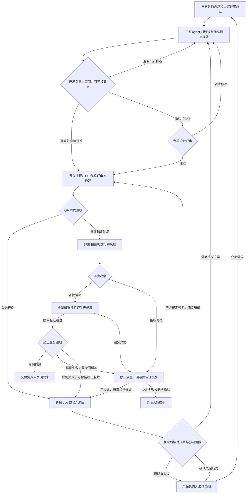

# ohoo 产品设计：多租户 Team 流程编排平台

**状态**　一期试点范围与后续模板设计 · 2026-11-08

ohoo 让组织成员用已有的 coding agent、skills 和 CLI 组建协作团队。成员把自己有权访问的会议纪要、需求和讨论带到角色会话里，与 agent 一起处理材料，再把结果交给下一位。租户自行决定有哪些角色、怎样交接、要留下哪些产物，以及何时完成。

**一期的入口是画布上的角色节点。** 成员配置「需求整理」节点，点击它，打开类似 Paseo 的 agent 操作面板。在对话里粘贴几句会议决定，要求 agent 整理需求草稿，直接改正范围，再把选定版本和交接摘要提交给负责人。负责人在自己的面板里签收。这条链路可以在没有任何组织系统连接器的情况下完成。

配套动画用 3 分 10 秒展示平台的目标形态。前 24 秒比较两个租户的自定义团队，后续以订单研发团队演示设计、开发、QA、发布和生产验收。片中服务连接、自动化和发布回执均为模拟；一期交付按第 2 节的试点用例验收。[观看目标形态模拟演示](media/team-delivery-demo.mp4)

## 1. 租户怎样创建自己的 Team

**租户**是工作区、成员和资源的权限边界。**Team**是工作区内为某类目标协作的成员和角色。**流程版本**记录这个团队当时使用的角色、交接方式和完成条件。**运行**是一次具体委托，例如基于某场会议拟定一份需求。每次运行有自己的会话、输入、产物和状态。

1. **建立团队。** 有权建队的成员选择工作区，从空白创建 Team，填写名称、目标、负责人和成员。已有团队可以把角色和连线保存为可复用的配置。复用时重新核对本团队的成员、账号和可用资源。
2. **定义角色。** 选定负责这项工作的人，写清其职责、希望 agent 使用的现有 skills 或 CLI 配置、执行器、输入和产物。真人审批也可以直接作为一个角色。画布上可以给同一职责配置不同成员和资源。
3. **配置交接。** 拖入角色并连接两端。每条线写清「谁在什么结果下，把哪一版产物交给谁」，选择手动转交或满足条件后自动转交。移动节点只调整布局。保存为草稿、启用流程版本、发起一次工作是三个独立动作。
4. **约定结束。** 租户设置产物种类、字段、必填项和承载方式。一份产物可以是会话中确认的文本、外部链接或团队已有存储中的文件引用。结束条件可以是指定人签收某一版需求，也可以是稿件归档。需要对外发布的团队自行定义发布流程、负责人与条件。
5. **发起与复用。** 发起委托，点击首个角色节点，在这次运行的操作面板中直接分派任务、递交材料。运行引用启动时的流程版本，后续编辑供新运行使用。调用已有工具时沿用该工具的实际账号和当前权限。

### 两种可选团队配置

| 租户与 Team | 可以选择的角色和交接 | 自定义完成条件 |
| --- | --- | --- |
| 甲租户 · 订单研发团队 | 开发 agent 按需求和仓库提出方案，开发负责人直接修改；团队可另设 QA、SRE，约定制品测试、放行和回滚流程 | 该团队可以要求指定制品通过生产验收并获产品负责人签收 |
| 乙租户 · 内容编辑团队 | 撰稿 agent 把草稿和出处交给编辑。编辑直接改稿、签收，或附意见退回修改；两次送审各自引用稿件版本 | 编辑签收本版定稿，归档稿件链接或文件 |

两个团队都能从空白配置。角色名称、产物字段、结束条件和业务动作属于租户。新团队的画布从空白起步，QA、SRE 以及生产发布仅出现在选用这些角色与动作的团队中。

## 2. 一期先做可直接操作的角色节点

### 成员怎样把材料交给 agent

在节点的操作面板里，成员像使用 coding agent 一样直接交代工作。可以粘贴一段话、文档链接、会议纪要或转写，提供已有文件，或者指明当前工作目录里的一份资料。打开或续接已有会话时，面板显示本次运行、当前角色、执行身份与会话状态，避免把材料交错角色。

例如，成员贴入「本次只处理已结算订单」和一条飞书文档链接。agent 可以据此写出草稿，并注明这项范围来自成员的说明。链接是成员提供的引用。只有现有 skill 或 CLI 支持读取、且该成员的实际账号有权访问时，agent 才能引用读到的原文。条件不足时，成员可以改贴相关段落或手写摘要；仅凭链接无法确认的内容保持待核实。视频会议的纪要或转写也按同样方式提供。

### 一期产品清单

| 能力 | 试点成员实际能做的事 |
| --- | --- |
| 角色与执行 | 为节点配置人的职责、代表的具体成员或账号、现有 skills/CLI、执行器和交付要求。用一种真实可用的 coding agent 发起工作 |
| 节点操作面板 | 点击已配置节点，打开该角色在本次运行中的 agent 会话，直接下达任务，补充文字、链接、纪要、转写或已有文件，查看执行状态和回答 |
| 人机共作 | 在原会话中追问、改稿、停止执行、接手和交还。工作台可以定位到等待自己处理的角色和任务 |
| 轻量画布 | 拖节点、连线、保存草稿与版本。手动交接或满足明确结果后自动转交。下游从显式提交的产物和交接摘要开始自己的工作 |
| 自定义产物与结束 | 配置需求稿、会议决定、文稿等类型，自定字段和文本、链接或文件形式；明确由谁签收哪一版、何时结束。业务另有发布步骤时由租户自行配置 |

### 一期验收

1. **在无连接器的工作区开工。** 甲租户成员配置需求整理角色，点节点打开 agent 面板，粘贴会议结论或提供一份已有文件。agent 应能据此起草需求，并指出哪些问题仅凭现有材料无法确认。
2. **缺资料时继续对话。** 成员追加文档链接。如果当前工具无法读取，agent 请成员补充可分享的摘录或摘要，继续完成草稿；如果成员自己的工具和账号已具备读取能力，才引用实际读到的内容。撤权后再次尝试，应按工具的实际结果处理。
3. **人在原会话里改。** 成员追问草稿依据、纠正范围，停止当前执行并接手编辑，再交还修订稿。agent 从该版本继续，旧版本与修改人可追溯。
4. **只交付选定内容。** 会话中放入一段私有工作笔记，再显式提交需求稿 v2 和一句交接摘要。分别执行手动交接与按规则自动交接。负责人在自己的面板里只收到这份产物和摘要，可以退回或签收；私人笔记、原会话和登录凭据均不会随交接传递。重复提交同一次交接不生成两份待办。
5. **换团队仍能运行。** 乙租户用同一组控件配置撰稿和编辑，产物设成「稿件链接＋编辑意见」，结束条件设成「编辑签收定稿」。新规则适用于新委托；在途工作保留原版本。乙租户成员不能打开甲的会话、产物或执行器连接。
6. **沿用团队自己的发布方式。** 有发布需求的团队可增加「发布记录」类型，负责人用个人账号在已有 CLI 或原发布工具中操作，显式提交版本与回执，由团队约定的人签收。对外部稿件或文件的签收绑定固定版本或获准保存的快照；可变链接本身仅作引用。

试点观察从打开角色面板到负责人签收产物的耗时，记录成员何时需要补材料、接手或重复解释同一决定。CI/CD、监控、多层设计评审、复杂并行调度、自动灰度与回滚留给需要这些能力的后续试点。专用沙箱与任务级隔离执行环境后置；一期沿用实际执行身份和既有工具授权。

## 3. 角色、会话与画布怎样一起工作

### 角色代表谁，能做什么

以「需求整理」为例。成员把自己梳理会议决定、撰写需求的职责写成角色说明，选择自己已有的技能，例如需求整理 skill 或已配置的 CLI。再为这个节点选择实际运行的 coding agent，明确代表哪位成员或哪个获授权执行账号。界面应分别显示**业务负责人、执行身份和工具授权范围**，让操作者知道本次是谁在读、以谁的身份提交。

面板显示该角色配置的工具和执行身份，已有 CLI 使用其实际登录账号。成员甲授权的角色不会因团队里还有成员乙就得到乙的权限。允许任意 shell 的环境中，角色说明只能约定工作方式，无法强制收窄宿主账号的权限。若工具以应用或 bot 账号登录，须显示该身份；要求以成员本人执行的动作应使用本人可核验的操作路径。

成员可以续接自己的原生会话。向下游提交时，先看交接预览：本次提交的产物及版本、交接摘要、接收角色。接收者只收到发送方显式提交的产物和交接摘要，来源链接或待办可以写入其中。草稿对话、上传给该角色的私有材料、原生会话句柄和登录凭据留在原角色的执行环境。接收者在自己的面板和授权范围内继续。

### 绑定 coding agent 时，列表从哪里来

**先连接成员的执行环境，再为角色选 agent。** 例如，李工把自己的 Mac 接入工作区一次。创建 QA 角色时，他可以选择「李工的 Mac → Claude Code」，另一个开发角色也可以复用这台机器。手机或浏览器打开同一节点时，仍然控制李工选定的执行环境。李工也可以明确选择他有权使用的远端开发机。角色本身无需安装软件。

1. **第一次配置。** 节点显示「连接我的电脑或开发机」。连上后由该机的执行适配层列出实际发现的 coding agent、可用模型和必要能力。选择器显示设备名、执行账号、最近检测时间，以及账号身份是否已验证。
2. **以后配置。** 优先预选该成员指定的默认环境与兼容的 agent。只有一个合适选项时可预选，有多个时让成员选择。模板可以推荐 Claude Code 等 provider，复制模板时由新成员完成个人绑定。没有环境或可用 agent 时可以先存角色草稿。
3. **第一次运行。** 区分「环境在线」「已发现程序」「已成功运行」。首次打开节点时复核工作目录和当前绑定，用用户发起的轻量任务验证实际调用。鉴权失败、环境离线和未发现 CLI 分别给出处理入口。原绑定失效时保留它，提供重新检测、修正路径或显式换机；换执行器后由新会话接续已提交的工作。

### 人如何进入角色会话

在画布点选已配置的角色节点，直接打开该角色的 agent 操作面板。面板顶部显示角色、执行器、实际账号与状态，主体是当前会话，输入区可粘贴资料或提供已有文件。未启动时可在此发起工作，已有会话则继续本次运行。成员可直接下达任务、追问依据、指正回答和编辑产物。需要自己处理时点击「接手」，等待执行器确认原回合已停止或结束再接管写入。无法通过已接入接口中断时，界面引导成员回到原工具处理，并保留待核对状态。「交还」记录产物版本、人工修改和下一步。会话中可以直接完成手动交接，其余角色的工作按各自约定继续。

Paseo 式面板描述的是成员操作 coding agent 的体验。底层可集中管理已有会话，也可评估采用 Paseo 承接执行和会话接续。试点先验证一种执行路径的启动、停止、恢复与身份约束。Codex、Claude Code、pi 等可按真实接入情况出现在选择器中，平台显示各自可用的工具和资源范围。

### 画布上配置什么

拖入角色后可查看职责、绑定身份、执行器、现有 skills/CLI、工作目录和预期输出。负责人连接角色，配置「需求草稿完成 → 手动交负责人」或「编辑签收定稿 → 自动归档」等规则。运行工作台显示当前责任人、已交付版本和等待状态，获授权的成员可点节点进入自己的会话，或沿交接记录查看已提交的出处与实际处理人。后续团队需要更复杂的并行、依赖、返工预算或发布策略时，再扩展规则与集成。

以下第 4–8 节保留订单研发团队的**可选目标模板和后续演示**。其中的 QA、SRE、设计评审、预发、生产放行及监控都由这个团队选择。模板按团队已有工具和自定义流程运行。第 2 节定义当前一期验收边界。

## 4. 订单研发模板：一条需求从产品流转到生产

以下以订单团队承接「给订单列表增加 CSV 导出」为例。样例里一页显示 20 条，筛选条件共命中 43 条。数字用于说明如何验收，各服务可自定发布阈值和观察时间。

**配置 QA 节点。** 本例为一名有订单预发权限的测试成员建立 QA 角色，职责是独立验收候选制品。节点选择现有的「读提交差异、运行预发用例、写测试报告」能力，将执行范围限定在订单仓库和预发工具。模拟演示绑定 Claude Code，实际团队选择已验证的执行器。试跑时输入一个模拟制品和预期 2 行的用例，实际仅 1 行，角色应交出带制品标识的报告与可复现样例。保存角色后，团队把它拖入画布，分别连接「失败 → 开发」和「签收 → SRE」。

本模板还可给同一个开发角色设置设计、实现和已知缺陷修复三类工作。开发负责人对技术方案负责，交付负责人跟踪整条需求。两者可以由同一成员担任，各项组织与执行动作仍使用被代表成员的有效授权。

| 阶段 | 谁负责，做什么 | 转交下一棒的条件与证据 |
| --- | --- | --- |
| 需求澄清与评审 | 产品角色整理用户场景、范围和验收样例，产品负责人回答导出范围问题并确认本版需求。参与评审的成员把意见挂在这版需求上 | 需求评审记录引用产品决定 D-01 和 43 条验收样例，写明「沿用列表的权限与排序」，附确认人、需求版本及未决项。开发与 QA 从这份记录开始工作 |
| 形成技术设计 | 开发 agent 读取已确认的需求、需求评审结论和目标仓库，在指定提交上查找现有订单查询、权限过滤、排序及 CSV 写入代码。QA 并行准备用例，SRE 准备监控与回退条件 | 交付设计草稿，列出可复用的代码、计划改动、影响范围、待决定事项和验证方法，每项关键判断附代码或评审依据 |
| 开发负责人审设计 | 开发负责人在同一份方案上编辑、批注或退回。确认后选择直接开工或送设计评审 | 直接开工时，开发和 QA 收到确认版。送审时，指定评审者的结论写回该版本，通过后才启动依赖它的实现 |
| 开发与评审 | 开发在功能分支实现、编写测试，提交 PR。评审检查差异、数据权限和边界条件，发现缺陷就附具体意见退回开发 | 评审通过，按仓库策略合入并由 CI 构建。记录提交、候选制品标识、自测结果与评审结论 |
| 预发测试 | QA 在预发部署该候选制品，验证用户路径和回归用例。若实际只导出 20 条，将失败样例和复现数据退给开发 | 修复生成新候选版本。QA 对新版本复验并签收，把制品标识、用例结果和预发报告交给 SRE |
| 发布与灰度 | SRE 核对制品、目标环境、稳定版本、观察指标和停止条件，按团队策略取得放行。先向少量流量发布，逐批观察导出错误率和订单接口延迟 | 只放量 QA 签收的制品。每批记录部署回执、流量比例、观察窗口与指标。满足放量条件后进入下一批，直至全量 |
| 线上验证与关闭 | SRE 在全量观察窗口内验证服务健康并运行生产冒烟测试。QA 用受控账号从真实入口导出，产品负责人核对业务样例 | 线上版本、健康指标、导出 43 条及权限样例均有证据。交付负责人据此关闭需求，保留发布与验收记录 |

需求页分别展示**已部署、生产运行健康、业务验收通过**。部署流水线成功只能更新部署状态。监控缺失时保留「待验证」。即使各项技术指标正常，只要线上实际导出的数据与约定不符，需求仍在验收中。

### 开发 agent 和负责人怎样一起定方案

在 OD-43 上，产品决定 D-01 是「导出全部筛选结果，仅限有权限的订单」，上游需求评审还留下「沿用列表读取权限和排序」的结论。以下代码行为是订单服务的演示设定。实际任务引用所选仓库的提交、文件或符号。

1. **开发 agent 交出设计 v1。** 它定位到已有订单列表查询会过滤权限并排序，CSV 写入器可复用。v1 提议分页取数、写入 CSV，并在导出层再做一次权限判断。方案页并排显示上游依据与代码引用，开发负责人可以点回原需求、评审意见和实现位置，核对是否需要重复判断。
2. **开发负责人直接修改。** 负责人把「导出层另写权限判断」改为「逐页复用列表查询的权限过滤和排序」，并批注「增加第二页和受限账号的回归用例」。保存为 v2，界面保留 v1、修改人、差异及批注。负责人也可以选择「退回修改」，由开发 agent 回应每条意见、提交修订版，再请负责人复核。若意见改变业务范围，则向产品负责人发起澄清并关联原决定。
3. **确认方案后选择下一棒。** 方案页提供两个动作，按团队对该服务的评审规则开放：

| 开发负责人的选择 | 系统如何推进 |
| --- | --- |
| **确认并直接开发** | 本例复用既有查询，开发负责人选择这条路径。系统把确认版 v2 及代码基线交给开发，把新增样例交给 QA。开发按 v2 实现，提交 PR 后按仓库规则做代码评审 |
| **确认并送设计评审** | 负责人选定评审者，例如共享查询的维护者，附上具体问题和 v2。通过则把通过的设计版本交给开发。要求修改则退回原方案，生成修订版，由开发负责人复核并重新送审。团队配置为必经的专项评审会显示其触发原因 |

需求评审确认业务目标，开发负责人的设计 review 确认实现方案，专项设计评审解决需要其他角色参与的技术问题，PR 代码评审检查实际改动和测试。每个结论都指向它审过的对象与版本。设计确认后如果上游决定或相关代码发生了会影响方案的变化，系统标记相关条目待复核，再按更新后的版本接续。

### Bug 可以直接从复现开始

新报缺陷和 QA 退回都能进入「直接修复」。本例中 RC-1 应导出 43 条，实际只有第一页的 20 条。QA 提供版本、输入、预期与实际结果，开发 agent 复现后发现分页循环提前结束。既定行为和 v2 设计都清楚，开发沿用原工作项，先加入能复现漏页的回归用例，再修复循环并提交修复 PR。代码评审完成后，QA 在 RC-2 重跑同一样例，得到 43 条并签收。

缺少复现证据时，先补证据。若预期行为有争议，由产品负责人决定；若修复需要改变共享接口、权限约定或已确认的设计，由开发负责人审修改方案，并决定是否送专项设计评审。已有复现、代码调查和测试结果随原缺陷单保留。直接修复沿用仓库的代码评审、测试及服务发布规则。

## 5. 订单模板中的自动推进与人工介入

团队负责人在画布中为每类动作选择**自动执行、由 agent 提案后等人确认、直接交给人执行**，并指定异常时负责应答的成员。内容团队可以允许自动起草、要求编辑签收定稿。下面是订单研发团队的配置，其中生产放行和回滚分别授权。

| 情况 | 可以自动推进的动作 | 哪一步需要人介入 |
| --- | --- | --- |
| 需求与技术设计 | 对照上游需求和评审意见读取代码、提交设计草稿、按批注修订 | 业务取舍由产品负责人决定。功能需求的技术方案由开发负责人修改或确认，并选择直接开发或送设计评审 |
| 可复现的局部 bug | 按既定验收条件直接定位、补回归测试、修复并提交 PR | 预期行为有争议时请产品负责人裁定，影响接口或原方案时转开发负责人审设计 |
| 开发、评审与 QA | 编码、自测、评审、在预发复验、退回缺陷并重试 | 超出授权范围、达到返工或预算上限、无法协调并行改动时，交付负责人保留已有产物，请指定成员决定改派、缩小范围或追加预算 |
| 发布与放量 | SRE 按预授权策略调用流水线，根据指定版本的观测结果推进 | 配置为人工放行时，发布负责人查看候选版本、环境、QA 证据和回滚目标后批准或退回。新制品需要重新满足放行条件 |
| 生产异常与验收 | SRE 可在授权范围内止损、回滚、确认恢复。QA 可运行生产验收样例 | 回滚失败或无法确认恢复时转值班人员接手。最终业务签收由团队指定的验收人负责，示例中为产品负责人 |

**交接靠事件继续。** CI 完成、QA 签收、人工答复或灰度观察窗口结束后，系统检查版本、证据和依赖，再唤起接收角色。接收者得到显式提交的产物及版本；必要的需求目标、产物链接与未决问题写进本次交接摘要。外部回执重复送达或 agent 断线重连时，从最近确认的结果继续。发布命令已发出但回执缺失时，SRE 先核对流水线和目标环境的实际结果，避免重复部署。

**人成为本次工作的参与者。** 成员可以直接进入角色会话。目标模板也可从「待我处理」定位到同一会话。每条请求写清待决定的问题、可选方案、agent 的建议、各方案影响哪些工作，以及应答人。答复写回原需求并更新相关验收条件，仅依赖该决定的工作等待。例如，在确定导出范围前，开发仍可检查现有 CSV 写入器的字段转义行为。人也可以在代码差异上批注、退回，或接手一个工作项。接手时该项的 agent 停止写入，其他独立分支继续。交还时记录人工修改的提交与说明，由接收角色针对新版本复验。

### 一次人机问答在界面上是什么样子

需求 OD-43 的活动时间线显示每条记录的**实际执行者、身份和动作**。例如「交付 agent · 提问」「产品负责人（人）· 决定」「系统 · 同步验收条件」「QA agent · 提交测试结果」。用户可以在同一条请求下追问、改写建议或附材料，仍可看到哪些工作正在等答复。

| 用户看到的记录 | 对正在进行的工作有什么影响 |
| --- | --- |
| **交付 agent → 产品负责人**　「当前页有 20 条，筛选结果有 43 条。我建议按筛选结果导出，这会增加跨页取数和权限测试。采用哪一种？」 | 取数范围待定。开发可调查现有 CSV 写入器，QA 可先准备权限用例 |
| **产品负责人（人）→ 交付 agent**　「全部筛选结果。只导出有权限的订单。」 | 负责人将这段答复提交为决定 D-01，归入 OD-43。系统保留原话、身份和确认时间。验收样例明确为「授权账号命中 43 条，应导出 43 条。受限账号只能导出可见订单」 |
| **系统 → 开发 agent、QA agent**　两人的工作项都收到 D-01 | 开发获得逐页取数与权限约束，QA 获得对应的跨页和越权样例。需求页显示哪些工作已接收决定，人无需把结论复制到两个会话 |

如果产品负责人随后改为「只导出当前页」，系统新增决定并注明它取代 D-01。交付 agent 列出受影响的实现和用例，重新打开对应工作项。原决定和依照它得出的旧测试结论仍留在历史里，其他独立工作继续。

## 6. 订单模板的交接上下文与档案

### 一次运行，三种阅读方式

- **当前摘要**回答「现在应该按什么做」。汇总团队目标、有效决定、当前产物版本、阻塞项、下一责任人。内容团队看到当前稿件和待回应的编辑意见，订单团队看到候选或线上版本和验收样例。每个结论都引用来源。人可以纠正摘要，修订记录标明更改者和理由。
- **产物与时间线**回答「这一结论从哪里来」。运行按时间列出人和 agent 显式提交的意见、修订、签收和工具回执，并记录对应产物版本。编辑可点回稿件和修改意见，研发可点回对应的 PR、测试报告、部署事件或监控窗口。
- **交接预览**回答「下一位实际上会读到什么」。发送方提交时，系统依照连线列出显式提交的产物、版本和摘要。接收者可以用自己的权限打开提交内容所引用的原始记录。在新的 coding agent 会话中，也能从同一处接续。

### OD-43 的上下文如何逐步形成

| 环节 | 谁留下什么 | 下一位怎样使用 |
| --- | --- | --- |
| 产品澄清 | 人确认 D-01，交付 agent 将原话整理为有权限的 43 条验收样例，并关联原请求 | 开发和 QA 共用这条决定，任何一方都可以追溯是谁确认了范围 |
| 设计与确认 | 开发 agent 记录需求评审意见、代码基线和设计 v1。开发负责人保存修改差异、批注、确认的 v2 及流转选择。若送评，另附评审者、结论和适用版本 | 开发收到经确认的设计及待办，QA 收到第二页和受限账号用例。交付负责人可追溯人为什么改方案、哪项实现还在等评审 |
| 开发与代码评审 | 开发 agent 提交关联 v2 的 PR 和自测结果，代码评审者留下结论，CI 回执关联实际提交与候选制品 RC-1 | QA 能找到要测的制品、改动范围、原验收样例及设计评审时追加的用例 |
| 预发与返工 | QA agent 记录 RC-1「预期 43、实际 20」及复现步骤。修复后的 RC-2 有独立报告，结果为 43，权限用例通过 | 开发从失败记录接手修复。SRE 收到 QA 对 RC-2 的签收和预发报告，RC-1 的结果保留为历史 |
| 发布与回滚 | 发布负责人的批准绑定 RC-2 和生产环境。流水线记录灰度范围，监控记录异常，SRE agent 附停止放量、回滚和恢复的证据 | 开发从同一张需求单领取故障样本。RC-3 的放行引用自己的评审、QA 签收和发布批准 |
| 线上验收与归档 | SRE agent 留下 RC-3 全量健康证据，QA agent 留下生产入口的导出与权限样例，产品负责人签收。交付 agent 整理交付摘要 | 读者先看到最终交付的 RC-3、是否满足 D-01 和签收人，再按需展开 RC-2 的回滚与 RC-1 的失败用例 |

**QA 把 RC-2 交给 SRE 时，接收者看到的内容示例**

> **OD-43 · QA agent → SRE agent · 等待生产放行**  
> **执行依据**　D-01 要求导出全部筛选结果。开发负责人确认的设计 v2 要求复用列表的权限过滤和排序，覆盖第二页及受限账号。  
> **当前制品**　RC-2。预发实测 43/43，权限用例通过。来源为 RC-2 的 CI 构建回执和 QA 预发报告。  
> **历史记录**　RC-1 实测 20/43，分页缺陷已在 RC-2 复验。  
> **下一步**　SRE 核对生产环境和回滚目标，向发布负责人申请放行 RC-2。此时生产批准仍待处理。

**整理规则。** 发送角色可以是人或 agent，按约定提交本次产物、变化和未决项。系统核对材料、版本及来源，接收角色签收或附原因退回。订单模板另由交付 agent 根据这些记录更新需求摘要。agent 尚待验证的判断标为「建议」，人的答复标为「已确认决定」，工具回执保留来源。证据不齐或互相矛盾时列为「待核实」并指派负责人补齐，过往结论保留其适用版本。

**记录的归属。** 某次 agent 会话的工具调用、尝试与日志留在该角色自己的会话环境。团队档案只收录显式提交的产物、交接摘要及其流转记录。决定、证据引用或待办可以作为产物或写入摘要，原始材料沿用其自身权限。运行关闭后保留最终摘要和各次交接。如果希望把本次经验用于其他任务，例如将跨页导出的用例纳入订单服务回归清单，由团队负责人确认适用范围与出处，再纳入本租户的团队模板。

## 7. 订单研发模板：返工、回滚与重新发布

**预发退回。** QA 在 RC-1 上得到「预期 43 条，实际 20 条」，重新打开原开发工作项。开发补充分页逻辑和回归用例，提交 RC-2。RC-1 的失败记录继续可查，RC-2 经评审和 QA 复验后才可发布。

**生产回滚。** 假设 RC-2 在灰度中触发错误率阈值，SRE 停止扩量、保留指标样本、切回已知健康版本，并验证订单服务恢复。这次发布记为「已回滚」，原需求记为「待修复」。开发依据故障样本修复，新的 RC-3 重新经过评审、预发和发布放行。若恢复失败，则由值班人员继续处理故障。一次需求可以关联多次发布尝试，每次尝试的版本、证据和结果都可追溯。

**线上业务样例失败。** 即便服务健康，QA 仍要把验收账号的权限条件、筛选条件和导出结果附到原需求。SRE 按服务策略判断是否撤回版本。需要撤回时执行回滚。允许保留当前版本时，需求标记为「业务验收未通过」，缺陷退回开发。修复制品重新通过评审、预发和发布后，系统再次派发线上复验，QA 重跑原失败样例，业务验收人签收后才可关闭。

## 8. 后续订单研发模板的验收场景

这组用例供后续研发试点验证完整模板，不计入当前一期交付。研发演练覆盖一个服务、一个仓库、一条 CI/CD 流水线和一个监控来源。在这个模板的运行工作台上，团队关注当前负责人、阻塞原因、已测版本、线上版本和下一步，点开交接可以查看对应 PR、测试报告、部署回执或人工决定。

| 验收场景 | 可观察的结果 |
| --- | --- |
| 从空白创建 QA | 用户可定义预发验收职责、勾选能力、绑定执行器并声明报告格式。试运行得到含版本和复现步骤的报告，保存后可将角色复用于团队 |
| 节点绑定与授权 | 两个节点可基于同一 QA 定义，分别绑定该试点实际接通的执行器与相应环境。缺少预发工具时提示缺能力，缺少预发访问权时提示缺权限。接入第二种引擎后再验证跨引擎绑定 |
| 服务负责人搭团队 | 拖入 QA 和 SRE，配置通过与退回两条交接并预览。发布新团队版本后，新需求使用新分工，进行中的需求仍能查到原分工 |
| 人确认业务范围 | 产品负责人在「待我处理」选定导出范围。开发和 QA 都收到更新后的验收样例，无需人转述，独立工作项持续推进 |
| 人改设计后直接开工 | 开发 agent 的 v1 引用上游评审和代码位置。开发负责人直接改为 v2、补充回归要求并确认开工。开发 PR 引用 v2，QA 收到新增用例，历史可查看原稿与人的修改 |
| 方案需要额外评审 | 开发负责人把具体设计版本送共享模块维护者。评审退回后作者提交修订版，负责人复核并重新送评。评审通过后实现自动接续，后续 PR 仍按仓库策略审实际代码 |
| 局部 bug 直接修复 | QA 关联 RC-1 漏页的复现记录。开发直接补用例、修复并提 PR，QA 在 RC-2 复验。若调查发现须改变共享接口，原工作项转回设计复核并保留调查结果 |
| 新的 SRE agent 接手 | 仅凭本次交接单就能指出有效决定 D-01、应发布的 RC-2、预发通过的证据和待处理的人工放行，并能打开 RC-1 的失败记录 |
| 人修订已有决定 | 需求摘要指向新决定，列出受影响的实现和用例。旧报告继续关联原决定，新条件下的相关检查显示为待复验 |
| 预发发现缺陷 | QA 提交失败样例后，开发收到原工作项并生成新版本，评审与 QA 自动接续。生产放行引用新版本的通过记录 |
| 灰度异常后恢复 | SRE 根据策略停止放量、回滚并确认恢复。需求保持打开，修复后重新发布，记录中能区分两次发布尝试 |
| 成功交付 | 已测制品与线上制品一致。全量观察和线上业务样例均通过后，交付负责人关闭需求。回看需求能追溯每次人工决定及其依据 |
| 交付后回看 | 读者从归档摘要找到 RC-3 的技术验收和业务签收，展开历史可查 RC-2 的回滚证据，并能辨认哪些文字是 agent 摘要、哪些来自人或工具 |

研发模板试用时按需求记录三个指标：达到业务验收的比例、从提需求到生产验收的耗时、需要人催办或转述上下文的次数。产品决策和按策略放行单独计数，以便区分有意保留的人工判断与可由系统完成的协调工作。

新版页面与完整操作路径见[Studio v2 界面设计](team-studio-v2-design.md)，可直接打开[新版交互原型](prototypes/studio-v2/index.html)。[第一版界面设计](team-workbench-ux-design.md)保留用于对照。节点会话、执行环境绑定和实施里程碑见[平台技术方案](team-orchestration-technical-design.md)。
