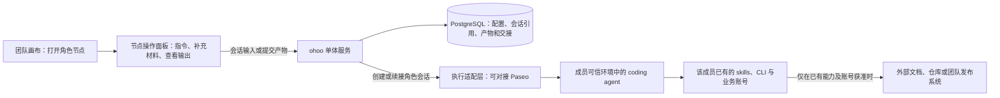

# ohoo 技术方案：团队编排与角色 Agent 操作台

**状态**　轻量 MVP 设计稿 v3 · 2026-11-08。已实现单工作区、真实 Paseo 会话、agent 间自动接手、设计评审、团队配置的 QA 与测试环境发布。候选按内容封存，退回、部署及验证依据实际命令回执推进。本机版采用 SQLite，多租户部署和 PostgreSQL 仍属后续设计。[运行本地 MVP](../README.md) · [设计评审实操](local-design-handoff.md) · [开发、QA 与 SRE 实操](local-test-release.md) · [产品设计](team-orchestration-product-design.md)。

## 1. 一期跑通什么

成员在团队画布上点开已配置的「需求整理」节点，进入该角色的 agent 操作面板。他可以先发一句任务，再在同一会话补一句会议结论、一段转写或一个飞书文档链接。Agent 根据收到的内容和自己已有的工具工作。成员可以继续追问、改稿，最后选择一个版本作为团队定义的「需求说明」交给开发负责人。即使整个团队没有配置任何第三方来源工具，粘贴的文本也足以完成这条流程。

**一期交付团队与角色配置、从节点打开的会话面板、轻量交接、租户自定义产物与发布规则。** 两个角色和一种真实执行器足以验收。ohoo 管理节点、会话归属、工作状态和产物。组织资料是用户按需提供给 agent 的会话输入，读外部内容的能力由角色运行环境中已有的工具提供。

## 2. 架构与职责



| 组件 | 一期职责 |
| --- | --- |
| Web 与单体服务 | TypeScript、React 团队画布、一个 API 服务。处理登录、角色绑定、节点操作面板、会话路由和工作状态。产物提交、交接和下一位待办在一个数据库事务内完成 |
| 执行适配层 | 登记成员已有的执行环境，保存受成员与租户约束的会话引用。第一条链路优先验证 Paseo 管理一种真实 coding agent，可用操作以实际版本的 PoC 为准 |
| 存储与部署 | 部署 Web、单体服务和 PostgreSQL，连接用户工作机或租户可信主机。数据库保存必要配置、会话引用、显式提交的产物及交接记录。原始材料和会话历史沿用执行器及用户现有工具的存储方式 |

## 3. 点击节点后，用户如何补充上下文

**操作台。** 节点配置页用于设定职责、skills、CLI、执行器和产物约定。点击已配置节点的「打开 agent」进入执行视图：顶部显示团队、角色、当前成员和会话状态；中间显示用户指令、agent 输出及可用的工具事件；底部输入区可随时补充说明、粘贴资料、提交文件引用。会话内提供继续、停止或接手、提交产物。可用的中断及附件形式按执行器能力展示。「类似 Paseo」描述这套以会话为中心的交互，执行器可以由 Paseo 承接，也可采用另一种可用会话适配方式。

| 用户在会话里做什么 | 输入到哪一层，谁来处理 |
| --- | --- |
| 粘贴会议结论、转写片段或自己写的摘要 | 作为用户消息送入当前角色会话。agent 可直接依据这些文本工作，用户可以在下一轮补充、纠正或说明哪条是已确认决定 |
| 发送飞书文档、会议或工单链接 | 输入是一个链接。角色已有对应 skill/CLI 且成员账号有权访问时，agent 可以调用它读取原文。工具缺失或访问被拒时，agent 说明实际结果，用户可改贴相关段落继续工作 |
| 提供文件或视频会议资料 | 按执行器支持的输入形式使用已有文件、附件、转写或会议摘要。输入区标明可用形式。单独一个会议链接仅作为引用，自动入会、录制和转写不属于节点打开动作 |
| 点「提交产物」 | 用户明确选定内容或外部版本引用，补充团队要求的字段和交接说明。只有这一步选中的材料进入团队工作记录；原生会话、个人工具凭据与未选输入留在原执行环境 |

例如，李工先输入「按团队模板整理这次需求」，下一轮补充「会上确认导出全部筛选结果，保留原排序」，再给一个文档链接作为参考。他无需退出会话、先到工作区登记数据源。当他将需求稿交给王工时，王工看到提交的稿件、版本、选定引用和待办。王工如需打开原文，由自己环境中的工具以本人账号访问。ohoo 校验的是团队内这次交接的权限，外部资料的读取由外部工具与原系统裁决。

## 4. 角色、skill、CLI 和人的身份

角色模板保存职责、建议用户提供的材料、所需 skills、CLI 配置引用、产物定义及何处需要人决定。节点实例另绑定有权承担该工作的具体成员。首版每个执行会话只代表一个已授权主体。

| 层次 | 开发负责人示例 |
| --- | --- |
| 角色约定 | 读需求及上游评审，引用代码起草设计，沿用团队指定版本的设计评审 skill。修改共享接口交给负责人决定 |
| 工具配置 | 选择成员已在用的仓库 CLI、资料读取工具和工作目录。记录 skill 版本、CLI 配置引用及预期业务账号。skill 描述工作方法，CLI 实际执行操作 |
| 真实身份 | 李工接受节点绑定，使用李工在该租户登记的执行环境和个人业务账号。分别验证执行环境身份、模型服务登录及各业务工具的账号 |
| 交付约定 | 团队要求一份「实施方案」，自行定义文档链接、基线提交和签收人。内容团队可换成「定稿」及一套完全不同的字段 |

**“同等权限”以同一个真实人的身份为准。** 人在同一账号和资源上能做的操作，agent 在成员已委托、接口支持且授权 scope 足够时可代为完成。来源系统拒绝本人时也应拒绝 agent。成员切换不会合并两个人的权限。某个来源只支持应用或 bot 身份时显示实际身份；要求由人执行的动作转给本人，或走可验证的用户授权路径。角色的 CLI 清单用于选择工具，在已有环境允许任意 shell 时，配置文字本身不能强制收窄宿主账号的能力。

**集中管理会话，分开实际账号。** 按 `(tenant_id, member_id, environment_id)` 绑定个人 Paseo endpoint、连接凭据引用和 CLI profile。可连接用户工作机，或租户集中主机上已有的独立系统账号和个人 daemon。配对凭据、业务 token 与 CLI 的 HOME 由其所有者管理。成为 Team 成员不会自动取得他人 daemon 的控制权。共享高权限系统账号的环境只适合明确接受共享身份的信任域，不能标为按人同权的部署。多租户可共用管理服务，一期不承接互不信任用户在同一系统账号下的任意脚本执行。[Paseo 安全与连接模型](https://paseo.sh/docs/security) · [Paseo 的 provider 来源](https://paseo.sh/docs/providers)

### 发现成员实际可用的 coding agent

**Paseo 的做法。** 用户先连接实际运行 agent 的电脑或服务器上的 daemon。Paseo 为支持的 CLI 提供适配器，发现执行机上已安装的工具，沿用该环境中的登录和配置。当前 SDK 文档提供 `client.providers.snapshot()` 查看发现状态，`client.providers.waitForReady({ cwd })` 等待发现结束并取得 provider 与模型。快照可含 `loading`，完成后分别为 `ready`、`unavailable` 或 `error`。创建会话时再指定所选 `provider/model` 和执行机上的工作目录。若 CLI 没出现在 daemon 的 PATH，可在该机配置显式启动命令。具体接口以 PoC 固定的 SDK 与 daemon 版本为准。[连接 daemon](https://paseo.sh/docs/connectivity) · [Paseo provider 发现接口](https://paseo.sh/docs/sdk/providers) · [自定义 CLI 命令](https://paseo.sh/docs/custom-providers)

v0.13.0 源码中，daemon 先调用各适配器的 `isAvailable`，再获取模型和模式目录。两步成功才将条目标为 `ready`。例如 pi 的诊断可检查认证文件是否存在，实际模型调用仍需有效凭据。因此界面把「已发现」与「此模型最近成功运行」显示为不同状态。[v0.13.0 发现逻辑](https://github.com/getpaseo/paseo/blob/v0.13.0/packages/server/src/server/agent/provider-snapshot-manager.ts#L1018-L1064) · [pi 诊断](https://github.com/getpaseo/paseo/blob/v0.13.0/packages/server/src/server/agent/providers/pi/agent.ts#L2734-L2759)

**ohoo 的绑定流程。** 成员先配对一个执行环境，允许后续多个角色复用。服务端只向这个租户、成员和环境对应的适配器请求发现结果。以执行机上的工作目录作为查询上下文，缓存 provider ID、可选模型、所需能力的检测结果和时间。用户主动刷新、绑定变化或启动失败时重新探测。网页只展示返回的目录，无需读取访问者电脑上的程序或凭据。

| 阶段 | ohoo 保存或验证的内容 |
| --- | --- |
| 角色模板 | 保存职责、skills、CLI 要求和可选的首选 provider。同一个定义可由不同成员在自己的环境中实例化 |
| 成员绑定 | 保存 `tenant + member + environment + provider/profile + model + cwd`。选择当前用户的默认环境，可明确切换至其已授权的远端环境。账号身份只有在执行侧能核实的时候才标为已验证 |
| 打开节点 | 核对环境在线、目录和所选 provider/模型可用。首次成功执行本轮任务后，记录该绑定最近一次验证时间；Paseo 的发现状态与业务 CLI 的资源授权分别显示 |
| 会话续接 | 以租户、成员、运行、节点和绑定定位原生会话 ID。同一绑定再次进入时继续本次会话。替换设备、账号或 provider 时显式建立新绑定，从已提交的交接材料继续，原会话保留归属 |

**故障提示。** 设备离线时展示缓存结果及检测时间；CLI 缺失时提示在所选执行机安装或设置路径；已发现 CLI 但授权未验证时允许用户发起试跑；只有出现明确的鉴权失败时才提示重新登录。未知错误保留诊断信息。多个环境或 provider 同时可用时，不静默改用另一个账号或执行器。

## 5. 人直接操作 agent，团队规则安排下一棒

1. **开始。** 成员点击节点，打开本次运行的角色面板，看到实际身份、工作目录、skills、CLI 和产物约定。服务端按租户、成员、运行和节点寻找 `session_ref`，存在则续接，否则按节点配置创建。用户从面板输入材料，个人凭据留在执行环境里。
2. **工作。** 成员可直接发指令、看输出、补材料、改方案、回答问题或退回重做。提供「继续原会话」入口，中断等动作按所接版本的实测能力开放。Paseo SDK 描述了创建、追加输入和订阅事件的能力；断线后查回原会话并补拉时间线，不能把客户端退出当作进程已停止。[Paseo SDK](https://paseo.sh/docs/sdk) · [会话接口](https://paseo.sh/docs/sdk/agents) · [事件恢复](https://paseo.sh/docs/sdk/events)
3. **交接。** 提交符合团队定义的产物、结果和未决项，按已发布规则为下一位建立待办。首版支持顺序、按结果分支、退回、待人决定。同一人可以继续自己的会话。换人则将产物和获准材料交给对方，以对方账号接续。
4. **自动程度。** 下一位的待办可自动创建。自动启动另一成员的 CLI 需其事先委托该动作、当前授权有效且个人环境可用。否则显示「待本人处理」，其他独立工作继续。人要求接手写入时先停止原回合或确认结束，状态未知则保留待核对。
5. **关闭。** 对照团队配置检查必需字段、目标产物版本及签收人。修改产物生成新修订，旧签收只用于旧版。若外部发布回执缺失，先核对原系统，再决定继续或重试。

**轻量流程实现。** 一份版本化 JSON 保存起点、角色节点、结果连线、产物约定和完成条件。每次工作固定一个版本。单体服务在事务中更新步骤、交接和待办，命令携带幂等键及预期修订，刷新后读当前状态。独立工作项可分别领取。复杂并行合流、无人值守的跨机调度及容错队列留待后续场景验证。

## 6. 团队自行定义产物和发布方式

平台固定产物标识、修订、来源、作者、访问范围及关联运行。业务类型、展示名、必需字段、签收人、发布动作与结束条件由租户定义。以下是团队填写的配置节选，`design-review` 和 `li-release` 分别指向团队已有的 skill 和成员自己的发布 CLI 配置。

```json
{
  "role": {
    "name": "开发负责人",
    "assignee": "member-li",
    "runtimeBinding": "li-personal-paseo",
    "skills": ["design-review@1"],
    "cliProfiles": ["li-repo", "li-release"]
  },
  "deliverable": {
    "key": "reviewed_plan",
    "label": "已评审的实施方案",
    "fields": [
      {"key": "document", "type": "link", "required": true},
      {"key": "base_commit", "type": "text", "required": true},
      {"key": "review_notes", "type": "text", "required": false}
    ]
  },
  "finish": {"artifact": "reviewed_plan", "revision": "current", "signedByRole": "开发负责人"}
}
```

本例在方案签收后就可以完成。另一个 Team 若以生产发布结束，可自定义「发布记录」类型，让指定成员调用已有 CLI 或打开其流水线，提交目标版本、发布链接与回执，再由团队指定的人签收。内容团队则可以要求稿件链接、编辑意见与定稿签收。首版支持文本、链接、文件引用、枚举和签收的组合。外部系统的发布许可依然对应实际账号、动作和目标版本。

签收外部文档或文件时，记录原系统提供的不可变版本，或在成员有权保存的目的地留存该次快照及内容哈希。普通可变链接可作为参考材料。拿不到固定版本或获准快照时，提示补充交付件后再签收。角色模板复制 skill、CLI 的逻辑名称及配置要求，接手者须绑定自己的 profile，源角色的登录凭据和原生会话不随模板复制。

## 7. 数据与接口

| 数据 | 一期保存什么 |
| --- | --- |
| 租户与团队 | 工作区、成员、团队、团队成员及配置权限。所有业务记录带租户键，列表与直接 ID 访问均校验所属租户及 Team |
| 个人执行环境与角色 | 执行器类型、环境绑定、成员及执行连接凭据引用。角色修订包含 skill/CLI 配置引用，外部资料所需的业务登录由成员已有工具管理 |
| 运行与会话 | 流程版本、本次输入、步骤状态、负责人、个人会话引用。会话引用只能在它绑定的租户和成员范围内使用 |
| 产物与交接 | 团队定义的字段、显式提交的内容或文件引用、产物修订、成员选定的参考链接、签收与退回记录。密钥和未经选择的私人对话不写入共享时间线 |

一期接口围绕三个用户动作组织。节点与角色配置随团队流程保存和发布。打开节点时检查当前成员及环境绑定，向执行器发送用户输入，并把原会话输出呈现在面板。提交产物时在一次事务内检查角色、必填字段、修订号和重复请求，再创建下游待办。事件记录授权人、实际执行账号、会话及已知结果。个人 CLI 的外部操作以相应工具或原系统的记录为准。

## 8. 实施顺序和验证

| 阶段 | 通过标准 |
| --- | --- |
| P0 · 打开节点直接工作 | 在没有任何第三方数据源配置的工作区，成员点击节点进入真实 agent 会话，发送任务，再粘贴一段会议结论。agent 按该段文字修订草稿；离开后再打开同一节点，能续接同一运行的会话。记录实际执行器版本、会话标识和执行账号 |
| P1 · 组队与交接 | 租户从空白创建两个角色，分别绑定成员已有的 skill、CLI 与执行身份。A 提交产物，B 使用自己的账号接手、签收或退回。重发同一提交只产生一个待办，B 不会收到 A 的私有会话和 token |
| P2 · 自定义交付 | 一个团队自行定义「实施方案」并接自己的发布流程，一个内容团队自行定义「签收稿件」。配置两套字段与结束条件即可分别完成，不需要添加按行业区分的代码分支 |
| P3 · 权限与异常 | 两位成员不能通过节点 ID 打开彼此的私人会话。若试点角色已有资料读取 CLI，对比人和其 agent 读同一受限链接的结果。若没有该工具，面板仍可接受用户手动补充材料。再验证跨租户访问、环境离线、发布回执缺失时的状态 |

先验证一种真实执行器，Paseo 是候选执行层。若 SDK 中个别操作缺失，可集中登记会话，让成员回到其已有工具完成该动作，再回填结果。记录从打开节点、补充材料到交付有效产物的耗时，及重新进入节点能否接续工作。既有 Paseo/Orca 研究供底座选型参考。[执行环境调研](research/2026-10-26-agent-workbench-survey.md)

P0 还需至少在一条路径上实测「确认 agent 停止写入 → 人修改产物 → agent 按新版本继续」。若 SDK 不能可靠中断，可在原工具完成并核验停止。仍无法确认的路径在 UI 中保持待核对。

P0 的发现验收使用同一模板、两名成员和两个环境。验证只在 A 的机器安装的 CLI 只对 A 的绑定可选；B 未连接环境也能保存角色草稿；发现 CLI 后首次真实调用遇到鉴权失败时显示相应原因；A 的机器离线后，节点保留原绑定与会话，不会转到 B 的环境执行。

**后续触发条件。** 有互不信任的代管执行需求后再设计平台沙箱。当大量无人值守的任务需要可靠并行与恢复时，再扩展独立 Worker、租约和持久调度。
