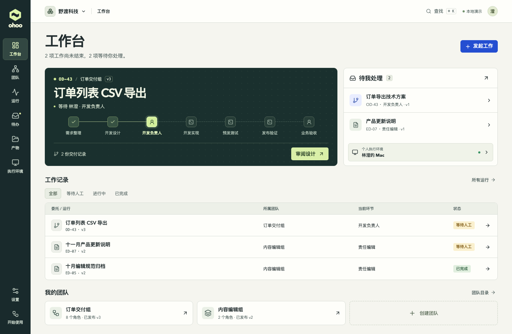
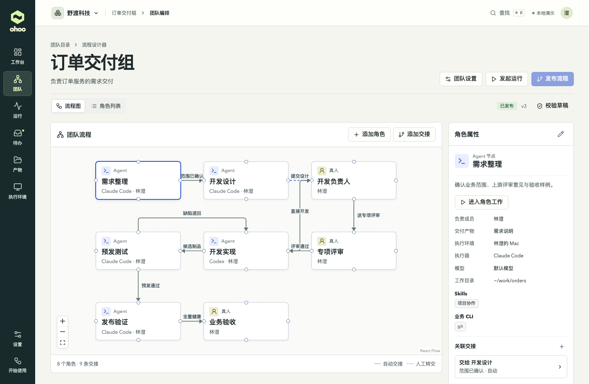
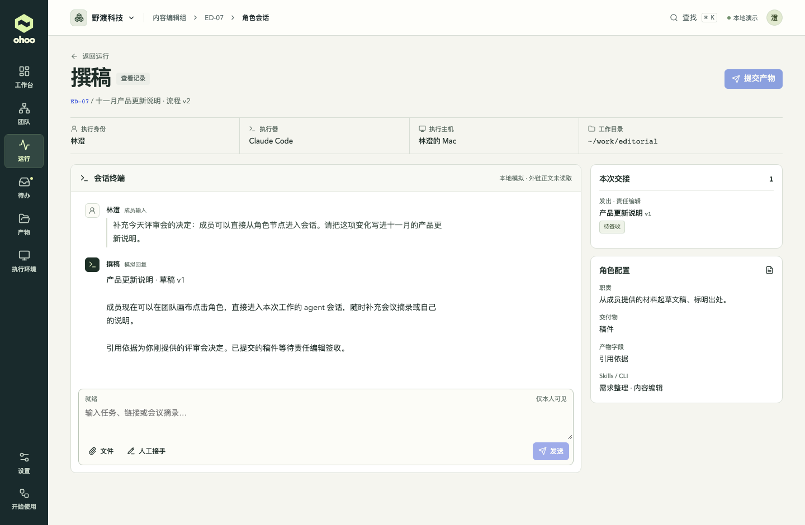
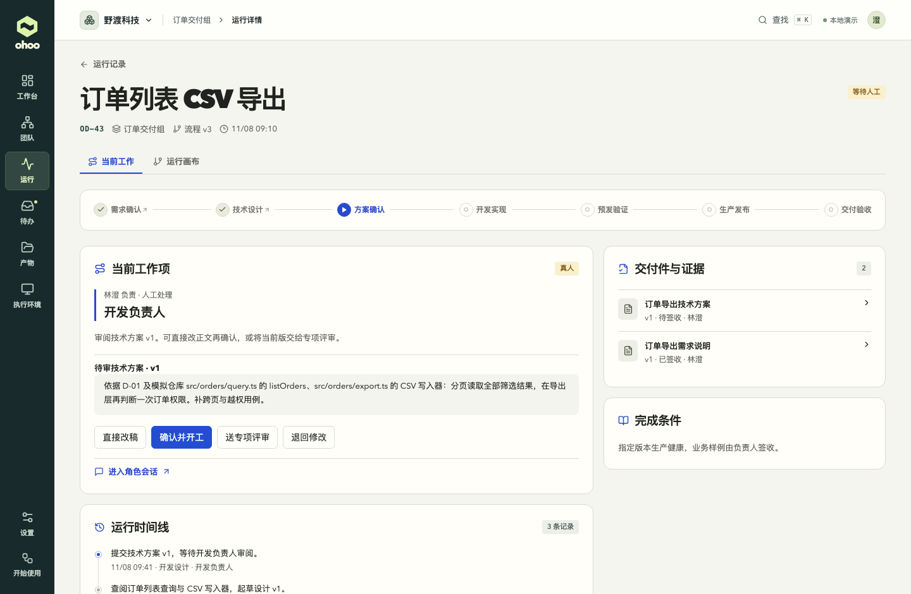

# ohoo Studio v2 · 完整工作台界面设计

[打开新版交互原型](prototypes/studio-v2/index.html) · [第一版原型](prototypes/workbench.html) · [产品设计](team-orchestration-product-design.md)

这版从成员当天要处理的工作开始。首页指出当前运行停在哪个角色、谁需要决定，以及决定之后会发生什么。团队负责人另有设计器，用来调整以后任务的分工。原型使用 React、React Flow、Radix Dialog 和 Lucide 图标，浏览器可直接打开。设备、账号、模型回复、CI 和发布均为本地模拟，状态保存在当前浏览器。

## 1. 页面与入口

| 界面 | 用户进来要做的事 | 去向 |
| --- | --- | --- |
| 工作台 | 找到当前运行、待审方案、个人环境和最近委托 | 直接处理待办，点运行中的角色进入其会话，或发起新工作 |
| 首次使用与工作区 | 选择 SaaS 或企业部署示例，创建工作区、连接设备、建立第一个 Team | 进入环境页或团队设计器；没有设备也可以先保存角色草稿 |
| 团队目录与流程设计器 | 从空白或模板建队，填写目标、成员及完成条件。拖入 Agent 或真人，配置职责、skills、CLI、执行器、模型、工作目录及产物必填字段 | 连接角色、设定交接结果和方式，校验并发布流程版本 |
| 执行环境与设置 | 成员选择自己的电脑或开发机，查看发现的 provider、模型和试跑结果。管理员管理成员及远端接入策略 | 回到角色绑定。离线保留原绑定，重连后重新验证 |
| 运行列表与详情 | 选择委托、查看团队版本、当前动作、时间线和证据。运行画布展示发起时固定的角色及连线 | 点击角色进入操作面板；在人工步骤直接修改方案或签收指定版本 |
| 角色会话 | 直接发指令、补材料、查看回答、停止、接手和交还 | 明确选定提交内容、必填字段及下游，再预览交接。个人会话保留在本人范围 |
| 待办与产物档案 | 处理指派给自己的决定；按运行号、名称查询已提交的产物，切换当前版本和历史 | 查看具体修订、退回意见及来源运行，核对最终交付 |

### 快速打开具体页面

下面的链接使用 SaaS 示例「野渡科技」。如果上次停留在企业工作区，先从顶栏选择对应示例，再打开链接。

- [首次使用与设备准备](prototypes/studio-v2/index.html#workspace=cloud&page=onboard) · [执行环境与试跑](prototypes/studio-v2/index.html#workspace=cloud&page=env)
- [团队目录](prototypes/studio-v2/index.html#workspace=cloud&page=teams) · [订单团队流程设计器](prototypes/studio-v2/index.html#workspace=cloud&page=canvas&team=orders)
- [开发负责人当前工作](prototypes/studio-v2/index.html#workspace=cloud&page=run&team=orders&run=OD-43&tab=action) · [本次运行的只读画布](prototypes/studio-v2/index.html#workspace=cloud&page=run&team=orders&run=OD-43&tab=map)
- [开发设计节点会话](prototypes/studio-v2/index.html#workspace=cloud&page=session&team=orders&run=OD-43&node=dev&tab=from-run) · [编辑签收 ED-07](prototypes/studio-v2/index.html#workspace=cloud&page=session&team=editorial&run=ED-07&node=editor&tab=from-run)
- [个人待办](prototypes/studio-v2/index.html#workspace=cloud&page=inbox) · [版本化产物档案](prototypes/studio-v2/index.html#workspace=cloud&page=artifacts)

## 2. 六条可操作的路径

### 建队与发布

在「团队 → 新建团队」选择空白、研发或内容模板。角色编辑表先填写职责和产物，再选负责成员及其执行环境。切换成员会清除不适用的个人绑定。设备发现的候选和实际试跑成功分别显示。可以先保存草稿，发布校验再定位不完整的节点或交接。

设计器中的移动只改布局。从发起节点的连接点拖到接收节点，或使用「添加交接」设置成功、退回或人工确认规则。点击「发起工作」选定团队已发布的版本，输入本次委托。此后编辑团队并发布新版，旧任务仍能回看自己实际使用的画布。

### 节点会话与内容交付

内容编辑组提供一个简短例子。从「待办」打开 ED-07 的 v1 稿件，填写意见并退回；回到撰稿节点，粘贴一段会议决定或文件。外链输入只代表用户提供了引用，模拟面板不会声称已读到链接正文。成员可停止当前回合、亲自改稿、写下交还说明，再继续工作。

「发送」把内容交给当前 agent。「提交产物」打开独立表单，填写团队规定的字段；预览只展示用户选定的正文、版本、摘要和接收人。手动交接需再确认转交，自动交接则在显式提交后创建下一棒。编辑签收 v2 后，可在档案里同时查到 v1 的退回和 v2 的签收。

### 功能需求与人工设计评审

首页的 OD-43 已走到开发负责人。打开「审阅设计 → 直接改稿」，将「导出层再次判断权限」改为「复用列表查询的权限和排序」。修改记录形成新版本。选择「确认并开工」会进入开发；选择「送专项评审」会先到审阅者，由其通过或退回，再继续实现。在途提交、决定和代码验收各自关联具体版本。

### Bug 直修与范围升级

从订单团队发起运行，选择「已复现的 bug」，附上复现步骤与预期结果，直接进入开发修复。也可以在预发遇到 43 条只导出 20 条时，提交失败样例退给开发。若预期有争议，请产品负责人澄清，确认既定行为后继续修复。若接口或原方案需要变化，回到设计复核。两条路径都继续使用原运行和已有证据。

### 灰度、恢复与最终验收

在订单示例中，QA 签收当前 RC 后才能放行这一版。可以模拟灰度异常，停止扩量、回滚并验证恢复，再生成新候选、重新送测和发布。全量后分别核验技术证据与线上业务样例。业务签收才关闭运行。研发操作属于示例团队的演练；编辑团队可以用「签收定稿」作为自己的结束条件。

### SaaS 与企业自部署

「野渡科技」和「北屿实验室」展示两种部署的同一套工作台。工作区成员、团队、待办、产物和设备随工作区切换。SaaS 侧显示托管入口；企业侧可维护实例地址及是否允许远端设备。原型中的跨部署选择器只用于切换示例，真实实例的成员和数据分别授权。

## 3. 视觉、设备与验证边界

侧栏固定展示工作台、团队、运行、待办、产物和环境。顶栏保留工作区与面包屑，支持按名称或运行号查找。首页深墨色运行卡突出当前负责人和可执行动作；钴蓝用于主要操作，状态同时使用颜色、图标和文字。角色详情在画布旁展示，运行操作和证据并排。小屏把图切为可点击的角色清单，签收、退回和继续会话无需拖动。

演示记录使用本机浏览器存储。工作区菜单中的「重置演示」可以恢复起始样例。真实登录、成员邀请投递、Paseo 连接、模型推理、发布回执和服务端隔离需在后续接入中验证。可在原型目录查看 React 源码并重新构建离线页面。
