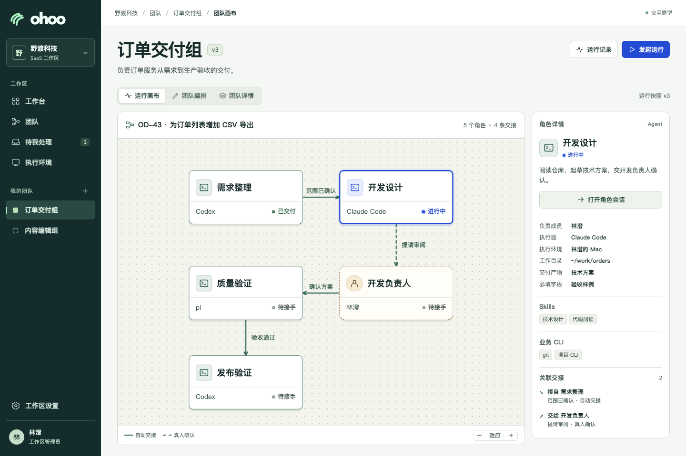
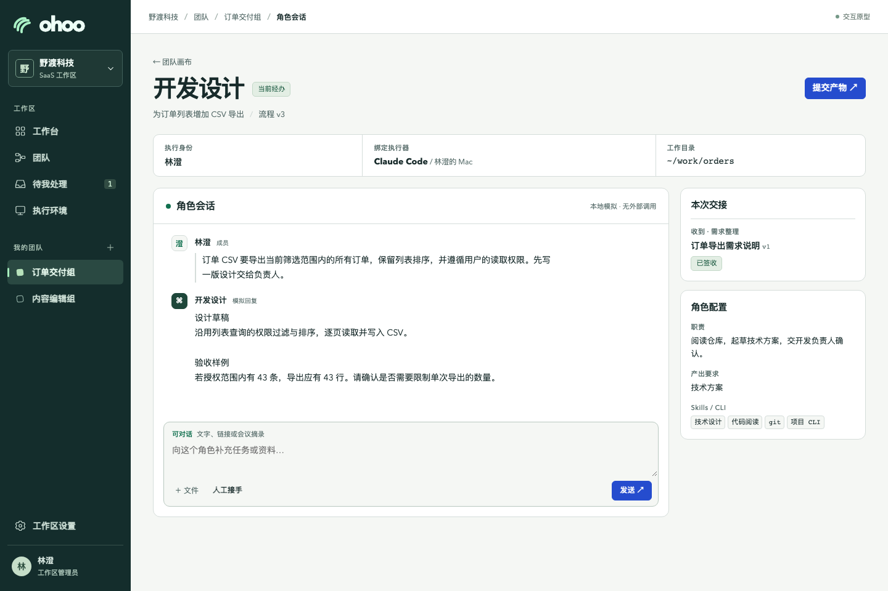

# ohoo 团队工作台交互设计

这一版保留了最初的画布与角色面板设计。[第二版完整流程与 React 原型](team-studio-v2-design.md)进一步覆盖首页、设计评审、缺陷修复、发布回滚和产物归档。

**状态**　一期目标设计。配套原型是可离线打开的单文件，演示数据与改动保存在当前浏览器。执行器发现、agent 回答和授权状态均为模拟。[打开可点击原型](prototypes/workbench.html)

**快速体验。** 首屏打开「野渡科技」SaaS 工作区的订单团队。点「开发设计」直接操作角色会话，粘贴会议摘录，再用「提交产物」预览交付内容。切到「团队编排」可编辑节点、配置交接并发布新版。打开侧栏工作区选择器，切换「北屿实验室」，可体验企业自部署的执行环境与设置。跨部署切换仅用于本地演示。正式产品的工作区切换限于当前实例及成员获准的工作区。原型默认以有管理权限的示例成员林澄操作。下文中的实例管理、真实登录、外部工具和断线恢复为目标设计。

一家企业可以使用托管的 SaaS 工作区，也可以在自己的基础设施部署 ohoo。无论采用哪种形态，成员开始工作时，都应该知道自己在哪个团队、由谁的账号执行、这次提交会让谁看到什么。下面用运营团队整理一份需求稿为例。李工代表「需求整理」角色，王工是签收需求的「业务负责人」。

## 1. 谁从哪里进入

| 使用者 | 入口与首要任务 | 完成后的去向 |
| --- | --- | --- |
| SaaS 工作区管理员 | 在托管入口选择已有工作区，或按组织授权创建工作区。进入「工作区设置」邀请成员、授予建队与发布权限，查看允许接入的执行环境 | 邀请打开后先显示工作区名称与身份，再进入团队列表。管理员可以查看连接归属与状态，成员自行绑定其个人执行账号 |
| 企业自部署实例管理员 | 在企业部署地址进入「实例管理」，配置组织登录入口、工作区和可信执行环境接入方式，检查实例与执行通道是否可用 | 将工作区地址交给成员。实例运维与团队业务有独立入口，处理一台机器的故障无需打开该机上的个人对话 |
| Team 负责人 | 在当前工作区的「团队」页建队、邀请承担角色的成员、设计画布、试跑并发布流程 | 发布后从团队页「发起运行」。后续修改在草稿中进行，每条已有运行仍能看到自己启动时的团队版本 |
| 团队成员 | 从「待我处理」打开指定工作，或在「工作台」和团队内的「运行记录」找到自己的委托。设备从「执行环境」接入一次，可供本人多个角色复用 | 从当前节点直接进入会话或查看待签收的产物。离开后可在同一工作项继续 |

两种部署共用「工作台」「团队」「待我处理」「执行环境」四个日常入口，「运行记录」归属具体 Team。工作区管理员从「工作区设置」管理成员、角色和团队授权。企业实例管理员另有实例级配置职责，原型在企业工作区的设置页演示服务地址及远端设备策略。切换工作区时重新加载团队、待办和环境列表。从通知或链接进入另一工作区时，先显示目标归属并核对成员权限。

## 2. 工作台页面与屏幕布局

**桌面。** 左侧栏顶部切换工作区，下方是日常工作入口和我的团队；顶栏显示当前位置。团队页把画布放在中间，右侧显示选中节点的职责、执行器与交接。「团队编排」编辑草稿，「运行画布」显示一次工作的版本快照，分别决定点击节点是编辑角色还是进入会话。打开角色后，会话占主区域，右侧可查看本次交接的产物与依据。

**窄屏。** 顶部保留工作区、Team 和返回入口。团队画布可切换为按角色列出的交接清单，每一行写出结果、接收者和所需产物。添加角色、选择上下游、修改规则均可用按钮完成。会话占主屏，底部保留输入栏。「本次产物」和「运行信息」各自打开，再返回时保留原会话和未发送的输入。待办可直接进入指定版本的签收页，适合人在手机上做决定。

## 3. 从空团队到可执行的角色

1. **新建 Team。** 负责人填写「需求整理组」、目标和成员，进入空白画布，选择「新增角色」。起点设为「需求整理」，结束条件设为「业务负责人签收一份需求说明」。团队可自定产物名称和必填字段，例如「业务范围」「验收样例」「待定事项」。
2. **配置职责与工具。** 角色编辑页先写「把会上已确认的决定整理成可验收的需求」，再选业务负责人、实际执行成员、所需 skills 和 CLI。示例选用李工已有的需求整理 skill 和文档读取 CLI profile，输入可用粘贴文本，输出是「需求说明」。工具详情显示用途、执行身份、工作目录、所需资源及最近检测结果。若账号尚无法核实，界面写「身份待核实」。角色草稿可先保存，成员稍后补全个人绑定。
3. **发现本人的执行器。** 李工在「执行环境」连接自己的电脑或有权使用的企业开发机。选设备和执行目录后，页面向该环境查询可用 provider 和模型，列出实际返回的候选、检测时间和能力。例如检测到 Codex 才显示该选项。只有存在兼容候选时才预选。成员明确选择 provider、模型与账号配置。设备在线、发现程序、最近一次成功执行分别显示。试跑一条无敏感内容的指令成功后，才更新此绑定的成功时间。CLI 的资源权限仍由执行时的真实身份决定。
4. **连线并发布。** 负责人把「需求整理」拖入画布，连到真人「业务负责人」，配置「提交需求说明 → 请王工签收」「王工退回 → 李工修订」。团队可选手动交接，也可约定某种产物显式提交后自动建立下一项待办。预览时显示接收人能读到的内容。移动节点仅改变位置。发布前逐项定位缺少执行者、必填产物或完成条件的问题。通过后发布团队流程 v1。草稿的保存时间和已发布版本分别可见。

## 4. 从运行直接进入角色会话

李工点「发起运行」，选择团队流程 v1，输入「确认订单导出范围」，确认起始角色。运行页显示「需求整理 · 李工 · 待开始」。点该节点即打开类似 Paseo 的会话面板。顶部固定本次运行、角色、代表的身份、环境、provider 和状态。首次输入创建该工作项的会话，此后从画布、待办或历史运行进入都续接同一个会话。真人节点则打开待审产物与可执行动作。也可以直接从 Team 画布进入。节点只有一项分配给本人的未完成工作时直接续接，有多项时先选运行。还没有运行时可从节点内发起第一项工作。

**材料随对话补充。** 李工先输入「按团队格式整理需求」，下一轮粘贴「会上确认导出全部筛选结果，保留列表排序」，随后补一份参考链接。面板显示自己的输入、agent 的回答以及执行器能提供的工具结果。若文档工具可读，agent 可引用实际读到的段落。若缺少 CLI 或没有读权，显示具体原因，李工仍可粘贴有权分享的摘录或自己的摘要。文件按执行器支持的方式提供。只有参考链接时，尚未核实的来源继续标为待确认。成员可以在同一处追问、纠正和改稿。一段回答生成后，运行仍停在当前节点。

## 5. 提交、签收与退回

**李工提交。** 在回答旁点「作为产物」，先生成可编辑的需求草稿。他选定正文、补齐验收样例，再点「提交并交接」。确认页并排显示这版需求说明、接收角色和一句交接摘要，可展开核对选中的引用。页面明确提示「王工将收到需求说明 v1、所选引用与摘要」。李工在会话中写过的个人笔记仍在自己的执行环境。外部可变链接只作为参考。要签收外部稿件，应选择来源的固定版本或有权保存的快照。

**王工处理。** 「待我处理」新增一条「需求说明 v1 待签收」。王工可签收、编辑后提交新版，或附带具体意见退回。例如他要求「补充受限账号只能导出可见订单的样例」。退回定位原运行、原工作项和 v1，李工从原会话继续，提交 v2。再次送审时，王工能同时看到 v1 意见、v2 差异以及本次签收对象。签收记录绑定版本、成员和时间，满足团队约定的完成条件后才关闭运行。重复点击提交或刷新页面应回到同一条交接。

**自动交接。** 如果团队把规则设为「需求说明提交后自动送审」，提交动作直接建立王工的待办。若下一棒是 agent，需要执行成员曾委托自动启动，且其环境和授权仍有效。否则显示「待本人开始」。团队流程的发布只启用工作规则。若团队还需对外发布文稿或制品，则自行设置发布角色、目标版本、回执和验收条件。

## 6. 接手、恢复与空状态

| 界面情形 | 系统显示与成员下一步 |
| --- | --- |
| 尚无团队、无环境或无可用 provider | 无团队时，有权限者可「新建 Team」，其他成员可查看邀请入口。未绑定设备可保存角色草稿。设备在线但未发现所需 CLI 时，显示设备、工作目录及修复路径，并提供「重新检测」 |
| 程序已发现，试跑失败 | 明确鉴权失败时提示在所选环境登录后再试。原因未知则保留诊断。设备离线时显示上次检测时间。更换机器、账号或 provider 由成员明确选择，新会话从已提交材料接续 |
| 人要接手修改 | 点「接手」后先请求停止当前回合。收到停止或结束确认才允许人工写入。接口不支持中断时引导回原工具，状态未知时显示「等待确认」。交还时选定人工修订版、说明改动与下一步，再恢复 agent 工作 |
| 页面断开或执行回执缺失 | 重连后回到原运行和会话，补齐时间线再显示可执行动作。不能恢复原会话时提示原因，并可从最近提交的版本启动新会话。涉及外部动作的结果未知时，先在原系统核对结果 |
| 接收方缺权限 | 运行链接、产物、会话与执行环境分别核对当前工作区和成员身份。能读需求说明的王工可以签收该说明。若他无权打开其中的外部原文，展示受限状态，可请求可分享摘录或退回补充证据。没有该运行访问权时返回当前工作区，不展示内容 |

## 7. 首版交互验收

1. 用 SaaS 和企业自部署入口各走一次。管理员可完成对应的工作区或实例配置，普通成员进入相同的团队工作台。切换工作区后，通过旧链接无法读取原租户的私有会话和产物。
2. 从空白建两个角色。李工绑定自己的环境和已发现的 provider，可在测试任务中区分「程序可用」与「调用已验证」。团队负责人能保存草稿、预览退回路径、发布 v1，并以该版发起工作。发布 v2 后原运行仍引用 v1。
3. 在没有组织来源工具的环境中，成员点节点、粘贴会议结论、追问并生成需求稿，离开后再打开仍继续原会话。加入不可读链接不会阻塞继续补充文本。
4. 提交前在会话留一段私有笔记。王工从窄屏待办只收到选定版本和摘要，退回 v1 后能看到 v2 的修改。仅签收当前版本才完成。重复提交不增加待办。
5. 在执行中请求人工接手，未确认停止前不出现可写编辑器。成员编辑、交还并重新进入后能定位最新版本及修改者。访问已撤销的环境连接时，页面提供重新绑定或改派入口。
